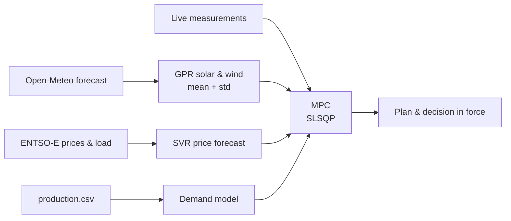

# Kairos – uncertainty-aware energy control

[](../../actions/workflows/ci.yml)

**Kairos** (Greek: the right moment) decides when a battery-backed production cell should take energy
from the grid, from the battery or store renewable energy. A model predictive controller (MPC) plans
grid import and battery use over a 24-hour horizon (96 × 15 min) and weights the renewable forecast by
its uncertainty:

- **Renewable forecast** – Open-Meteo weather forecast → physical solar/wind model → Gaussian process
  regression (GPR) residual correction, which also gives a standard deviation per time step.
- **Grid price** – ENTSO-E day-ahead prices for Hungary; missing future prices are predicted with a
  support vector regression (SVR) model.
- **Demand** – derived from the production schedule in `data/production.csv`.
- **Optimisation** – SLSQP (SciPy) minimises a cost combining SoC tracking, grid + battery wear cost,
  control smoothness and an uncertainty-weighted renewable term, subject to power balance and
  (uncertainty-tightened) SoC limits.

Developed by **József Szeles and Laura Deszát**, Department of System Engineering, University of Pannonia.



## Repository structure

```
├── config/dataConfig.json        battery, horizon, location and cost weights
├── data/
│   ├── ENTSOE_HU_Dataset_2025.csv    price, load and generation forecast history (SVR training)
│   ├── Past_Forecast_Values.csv      historical weather forecasts (GPR training input)
│   ├── Past_Real_Values.csv          measured weather for the same period (GPR training target)
│   ├── production.csv                production schedule used by the demand model
│   └── production_weekly.csv         weekly production pattern for the replay evaluation
├── src/
│   ├── settings.py                   paths, config loading, API key handling
│   ├── scicomp_training.py           trains the GPR solar and wind models
│   ├── svr_train_newest.py           trains the SVR grid price model
│   ├── referencemodel_functions.py   SoC, degradation, demand and power prediction models
│   ├── openmeteo_calling.py          Open-Meteo 15-minute forecast client
│   ├── svr_function_grid.py          ENTSO-E price fetch + SVR gap filling
│   ├── MPC_costfunction.py           builds the horizon and runs the MPC optimisation
│   ├── dashboard_app.py              Kairos web dashboard (start here)
│   ├── overview.py                   decision in force, costs, summary and timeline for the dashboard
│   ├── live_data.py                  storage of live measurements (data/live/, one CSV per day)
│   ├── live_simulator.py             sends simulated measurements, for testing without the real system
│   ├── run_log.py                    log of every MPC run and the results of the live operation
│   ├── update_data.py                downloads new training data from ENTSO-E and Open-Meteo
│   ├── features.py                   feature construction shared by training and prediction
│   ├── replay.py                     closed-loop replay of the controllers on past data
│   ├── calibrate_uncertainty.py      calibrates the forecast std the MPC uses
│   ├── tune_mpc.py                   Bayesian optimisation of the MPC weights on replays
│   └── templates/, static/           dashboard page, styles and charts
├── models/                       trained models are written here (not committed)
├── results/                      outputs are written here (not committed)
└── tests/                        unit tests (no network or trained models needed)
```

## Setup

Python 3.10 or newer is required.

**Windows (PowerShell)**

```powershell
git clone https://github.com/<owner>/uncertainty-aware-mpc.git
cd uncertainty-aware-mpc
python -m venv .venv
.\.venv\Scripts\Activate.ps1
pip install -r requirements.txt
Copy-Item .env.example .env   # then open .env and paste your ENTSO-E API key
```

**Linux / macOS**

```bash
git clone https://github.com/<owner>/uncertainty-aware-mpc.git
cd uncertainty-aware-mpc
python -m venv .venv && source .venv/bin/activate
pip install -r requirements.txt
cp .env.example .env          # then add your ENTSO-E API key
```

The ENTSO-E key can be requested free of charge on the
[ENTSO-E Transparency Platform](https://transparency.entsoe.eu) (account settings → Web API Security Token).
It can also be passed as the `ENTSOE_API_KEY` environment variable instead of a `.env` file.

## Dashboard

The easiest way to use Kairos is the local web dashboard:

```bash
python src/dashboard_app.py
```

It opens <http://127.0.0.1:8050> in the browser (Ctrl+C in the terminal stops it).

The **Overview** shows, at a glance:

- at the top, the latest **live measurements** (PV, wind, load, grid, battery, SoC) when live data is enabled;
- the **decision in force** for the current quarter-hour: how much of the load comes from the grid and
  from the battery, what happens to the renewable power, the grid price and what the cell costs right now;
- **costs** in EUR: today so far (measured when live data is available, otherwise planned) and the cost
  of the current plan compared with supplying the same load from the grid only;
- the status of the automatic MPC runs.
- a **timeline** (past 6 h and the plan ahead, with a "now" marker), one question at a time: where the
  energy comes from, the battery state of charge in its allowed range, renewable production with its
  uncertainty, and the grid price with the periods when the battery supplies the load.

The full plan can be downloaded as CSV from the Overview.

The other tabs edit the production schedule (`data/production.csv`) and the configuration
(`config/dataConfig.json`), and train the models / update the training data (**Models & data**).

Use `--port` to change the port and `--no-browser` to skip opening the browser.
The dashboard reads the API key from `.env` when it starts, so restart it after changing the key.

## Live measurements

With live data enabled, the Overview shows measurements from the real system: PV, wind, load, grid and battery power and the
state of charge, each with its age, a chart with the MPC plan overlaid (dashed, also for the hours
ahead, with a "now" marker), and measured vs. planned energy.

**Automatic MPC (receding horizon).** While live data is enabled, the dashboard runs the MPC by itself
every `live.mpc_interval_min` minutes (default 15, aligned to :00/:15/:30/:45; the first run starts
when the dashboard starts). Each run starts from the **measured** state of charge when it is fresh
(`live.measured_soc_max_age_s`), otherwise from `SoC.initial_soc`. Every plan is kept for 7 days in
`results/plans/`, so the timeline shows for each past moment the plan that was in force at that time.
`live.auto_mpc: false` turns the automatic runs off; "Run MPC now" on the Overview starts one at any time.

**1. Enable it** under Configuration → Live measurements (`live.enabled`), and set an API token.

**2. Send measurements** as JSON to `POST /api/live`, one object or a list of them, with the token in
the `X-API-Key` header. Every field except the time is optional; send what the system measures.

| Field | Unit | Meaning |
|---|---|---|
| `timestamp` | ISO 8601 | measurement time; without a UTC offset it is read as site local time (`general.timezone`); if missing, the time of arrival is used |
| `pv_w`, `wind_w` | W | PV and wind power |
| `load_w` | W | consumption of the production cell |
| `grid_w` | W | power taken from the grid |
| `battery_w` | W | battery power, **positive when discharging**, negative when charging |
| `soc` | 0–1 | battery state of charge |
| `curtailed_w` | W | renewable power that was available but not used (not stored) |

The fields follow the power balance of the cell (renewables and battery share a DC bus, the grid
feeds the load): `load_w = grid_w + battery_w + pv_w + wind_w − curtailed_w`. When load, grid and
battery are sent, the Overview checks this balance and warns if it does not close.

```powershell
Invoke-RestMethod -Method Post -Uri http://<dashboard-pc>:8050/api/live -ContentType "application/json" `
  -Headers @{ "X-API-Key" = "<token>" } -Body '{"pv_w": 12.4, "load_w": 24.0, "battery_w": 7.8, "soc": 0.56}'
```

```python
requests.post("http://<dashboard-pc>:8050/api/live", headers={"X-API-Key": "<token>"},
              json={"timestamp": "2026-10-16T14:30:00+02:00", "pv_w": 12.4, "soc": 0.56})
```

**Run log and results of the live operation.** Every MPC run (automatic or "Run MPC now") appends one
row to `results/runs/mpc_runs.csv` (time, starting SoC and its source, solver status and time, cost
terms, the settings that define the controller, the decision for the first step) and the plan rows in
force until the next run to `results/runs/decisions.csv`. The decision log is kept for the whole
experiment. Together with the measurements it gives, on the Overview card *Results of the live
operation* (today, 7 days, 30 days, all; totals and day by day), the same KPIs as the replay: cost and
saving against the grid only, leaving the planned SoC band (depth × time, share of steps below soc_min
and what the chance constraint promises), the battery protection cutting the plan, the battery energy
that was not delivered and its extra grid cost, and the MPC statistics. Results, run log and decision
log can be downloaded as CSV (`/api/live-results.csv?period=…`, `/api/run-log.csv`,
`/api/run-log.csv?what=decisions`).

Measurements are stored in `data/live/<date>.csv` (UTC dates, not committed). `GET /api/live/latest` and
`GET /api/live/history?hours=6` return them as JSON, e.g. for a digital twin.

**3. Network access.** By default the dashboard only listens on this computer. To accept measurements
from the lab network, start it with `python src/dashboard_app.py --host 0.0.0.0` (and allow port 8050 in
the firewall). Always set an API token in that case.

**Testing without the real system:** `python src/live_simulator.py --backfill 6` first sends six hours
of history and then one measurement every 5 seconds. The simulated cell follows the plan that was in
force at each moment (it re-reads the plans every minute), adds a correlated renewable forecast error,
respects the power and SoC limits and always satisfies the power balance above.

## Updating the training data

`Update data` on the Models & data tab (or `python src/update_data.py`) downloads everything since the last
stored row and appends it to the CSV files in `data/`:

- ENTSO-E day-ahead prices, load forecast and wind/solar forecast → `ENTSOE_HU_Dataset_2025.csv`
- Open-Meteo Historical Forecast API (forecasts issued for past days) → `Past_Forecast_Values.csv`
- Open-Meteo Historical Weather API (reanalysis, a few days behind) → `Past_Real_Values.csv`

Then retrain the models. The Models & data tab shows how old each dataset is, and the header warns when the
training data is more than 30 days old. `gpr.train_months` limits GPR training to the most recent
months, so training time stays constant as the history grows.

The weather files must be consistent with the live forecast: the same panel tilt/azimuth and the same
irradiance value (`openmeteo.gti_variable`: `instant` or `mean`). After changing any of these,
re-download the history with `python src/update_data.py --only weather --rebuild-from 2025-06-01`
(the previous files are kept as `.bak`) and retrain the GPR models.

> **Panel azimuth:** Open-Meteo uses **0° = south**, −90° = east, 90° = west, ±180° = north.

## Usage from the command line

The scripts can be started from any directory; all paths are resolved relative to the repository.

1. **Train the models** (once, or whenever the training data changes):

   ```bash
   python src/svr_train_newest.py      # SVR price model -> models/svr_model_15min.pkl
   python src/scicomp_training.py      # GPR models      -> models/gpr_*.joblib, models/scaler_*.joblib
   ```

   The SVR script shows a plot of the test prediction and saves it to `results/svr_test_prediction.png`;
   use `--no-plot` to skip the window. GPR training takes a few minutes; `gpr.max_train_samples` limits
   the training set (default 5000), which keeps training time and model size manageable.

2. **Run the MPC** (needs internet access and the API key):

   ```bash
   python src/MPC_costfunction.py
   ```

   The optimised schedule is written to `results/CostFunction_results.csv`.

The individual building blocks can also be run on their own, e.g. `python src/openmeteo_calling.py`
prints the current weather forecast and `python src/svr_function_grid.py` writes the next 24 hours of
grid prices to `results/SVR_results.csv`.

## Configuration

All parameters are in [`config/dataConfig.json`](config/dataConfig.json):

| Section | Keys | Meaning |
|---|---|---|
| `general` | `horizon`, `deltaT`, `timezone` | number of MPC steps, step length in seconds (96 × 900 s = 24 h), site time zone (used for the production schedule and prices) |
| `SoC` | `soc_min`, `soc_max`, `initial_soc`, `x_ref`, `eta_batt`, `E_capacity` | battery limits, start and reference SoC, efficiency, capacity (Wh) |
| `limits` | `p_charge_max_w`, `p_discharge_max_w`, `p_grid_max_w` | power limits (W); renewable power above the charge limit is curtailed |
| `degradation` | `c_deg` | degradation cost per Wh of battery throughput (€/Wh) |
| `pv` | `rated_power_w`, `efficiency` | physical PV model (power at 1000 W/m² and efficiency) |
| `wind` | `air_density`, `rotor_area_m2`, `power_coefficient`, `cut_in_speed_ms`, `rated_speed_ms`, `cut_out_speed_ms` | physical wind turbine model |
| `production` | `cat_time_s`, `cat_power_w` | time and power needed per produced unit |
| `openmeteo` | `latitude`, `longitude`, `tilt`, `azimuth`, `forecast_days`, `gti_variable` | site, PV orientation (azimuth: 0 = south) and irradiance value (`instant` / `mean`) for the weather forecast and history |
| `weights` | `w_x`, `w_u`, `w_delta_u`, `w_T`, `w_ff`, `lambda` | cost function weights; `lambda` scales how strongly forecast uncertainty reduces the feed-forward weight |
| `entsoe` | `country_code`, `history_days`, `cache_minutes` | ENTSO-E bidding zone, days of history fetched for the SVR price lags, how long downloaded data is reused |
| `gpr` | `max_train_samples`, `train_months`, `random_state` | GPR training set size limit (random subset), training window in months (0 = all data) and seed |
| `optimizer` | `maxiter`, `ftol` | SLSQP iteration limit and tolerance |
| `mpc` | `charge_is_decision`, `smoothness`, `soc_chance_z`, `uncertainty_scaling`, `sigma_ref_w`, `sigma_scale`, `error_autocorr` | how forecast uncertainty enters the MPC (see below) |
| `live` | `enabled`, `api_token`, `stale_after_s`, `use_measured_soc`, `measured_soc_max_age_s`, `auto_mpc`, `mpc_interval_min`, `deviation_abs_w`, `deviation_rel`, `deviation_soc` | live measurement input, automatic MPC runs and when a measured value counts as off-plan (see [Live measurements](#live-measurements)) |
| `replay` | `schedule_csv`, `replan_steps`, `validation_days`, `test_days`, `workers`, `violation_penalty_eur_per_pp_h`, `solver_ftol` | closed-loop evaluation on past data (see [Evaluation](#evaluation-replay-calibration-and-tuning)) |
| `tuning` | `mode`, `objectives`, `trials`, `initial_points`, `episodes`, `episode_days`, `random_state`, `params_<controller>` | Bayesian tuning of the MPC weights (`pareto`: several KPIs, `single`: one cost number); `params_*` are the search ranges `[low, high, "log" or "lin"]` |

Keys added in later versions are filled in with defaults when an older `dataConfig.json` is read; for
`mpc` these defaults reproduce the earlier behaviour (`uncertainty_scaling: "absolute"`, no calibration).

The GPR models learn the error of the physical PV and wind models, so **retrain the GPR models after
changing the `pv`, `wind` or `gpr` parameters**. All other parameters take effect at the next MPC run.

### How the optimisation works

The power balance `grid + battery discharge = demand` fixes the grid power once the discharge is known,
so the optimizer chooses the battery discharge for every step and, with `mpc.charge_is_decision`, also
how much of the renewable forecast is stored (the rest is curtailed).

The `mpc` section selects how the forecast uncertainty enters the problem:

| Setting | Default | Original | Effect |
|---|---|---|---|
| `charge_is_decision` | `true` | `false` | charging becomes a decision (0 … renewable forecast), so the battery cannot be overfilled on sunny days; `J_ff` then rewards following the forecast where it is confident (weight ρ = 1/(1+λσ²)) |
| `smoothness` | `inputs` | `total` | `total` penalises changes of grid + battery, which the power balance fixes to the demand, so it has no effect; `inputs` penalises changes of each input |
| `soc_chance_z` | `1.0` | `0` | tightens the SoC limits by z × the accumulated forecast std (z = 1 ≈ 84 %, 2 ≈ 98 % one-sided), so an uncertain renewable forecast keeps more reserve in the battery |

Setting the three values in the "Original" column reproduces the original formulation.

**Scale and calibration of the uncertainty.** Three settings make the uncertainty terms independent
of the system size and consistent with the observed forecast errors:

| Setting | Effect |
|---|---|
| `uncertainty_scaling` | `relative`: ρ = 1/(1 + λ (σ/σ_ref)²) with σ_ref = `sigma_ref_w` (0 = installed PV + wind power), so λ is dimensionless and keeps its meaning when the system is scaled. `absolute`: the original ρ = 1/(1 + λσ²), with λ in 1/W² (λ = 0.01 and σ ≈ 1 W give ρ ≈ 0.99, i.e. practically no effect) |
| `sigma_scale` | multiplies the GPR std. The GPR std is too small (overconfident); `calibrate_uncertainty.py` sets the factor so the std matches the observed errors |
| `error_autocorr` | AR(1) correlation of the forecast errors between two MPC steps. The SoC margin uses the std of the summed errors, which grows faster when errors persist (cloudy hours, wind ramps) than `sqrt(cumsum σ²)` assumes |
| `margin_window` | over how many steps the forecast error builds up into the SoC margin. `horizon` (original): over the whole plan. `replan`: only until the next MPC run, because every run starts again from the measured SoC; the window is the re-planning interval (live: `live.mpc_interval_min`, 15 min = 1 step; replay: `replay.replan_steps`). `steps`: `margin_steps` steps. In the closed-loop replay (72 Wh battery) `replan` cut the cost of the safest UA point by 0.8 % with the same SoC violation |
| `sigma_model` | `constant` (default): one factor `sigma_scale`. `weather`: the factor follows the forecast itself, exp(c0 + c1 · gust excess + c2 · irradiance variability / 100), coefficients `sigma_weather_coef` fitted by `calibrate_uncertainty.py`. `weather_floor`: the weather factor, never below `sigma_scale`. In the replay the weather models did not improve on `constant` |

Solar and wind errors are combined as independent (σ² = σ_solar² + σ_wind²); their measured correlation
on the held-out data is close to zero (`calibrate_uncertainty.py` reports it). The cost and its gradient are computed analytically,
which makes a 96-step run take about a second. Each run also writes `results/CostFunction_summary.json`
with the solver status and the value of every cost term; the dashboard warns if the optimizer did not
converge. The log of every run ends with a `[timing]` breakdown of the stages (weather forecast, GPR,
prices, optimisation).

Feature construction for the GPR and SVR models lives in `src/features.py` and is shared by training and
prediction. Differences and rolling statistics are defined over fixed time spans (1 h, 3 h), so the
models trained on hourly history see consistent inputs from the 15-minute forecast.

## Evaluation: replay, calibration and tuning

The replay answers "how would each controller have done on past days?" in closed loop: at every
re-planning time the controller only gets what it would have known then (forecast mean and std,
prices, production schedule), the plan is applied to a simulated cell driven by the **real** weather,
and the battery state carries over. It uses the held-out part of the weather data, which the GPR
models did not see in training (the last 20 %):

split into four separate periods (`replay.heldout_start` pins where the held-out data begins, so the
split does not move when new data is added; then `calibration_days`, `tuning_days`,
`development_days`, and the rest):

| Period | Used for |
|---|---|
| calibration | σ scale and error autocorrelation (`calibrate_uncertainty.py`) |
| tuning | Bayesian tuning of every controller with the same budget (`tune_mpc.py`) |
| development | ablations, the decision-rule map and every design decision (`replay.py`, default) |
| final test | run **once**, at the very end: `replay.py --period final_test --final`; every run is recorded in `results/replay/final_test_runs.log` |

With `calibration_days = 0` the older split is used (`validation_days` for calibration and tuning, the
rest as test period). Do not retrain the GPR models after adding new data while an evaluation is
running: the held-out data must stay unseen by the models.

Production follows `data/production_weekly.csv` (Weekday, Time, Mode, Target_Output; local time).

**Simulated cell and constraint violations.** `replay.plant` chooses the cell: `physical` keeps only the
physical SoC range 0–100 %, so leaving the planned band [soc_min, soc_max] is measured; `bms` adds a
battery management system that stops discharging at soc_min and charging at soc_max, and the grid covers
the shortfall. Three levels are reported separately:

| Level | KPIs |
|---|---|
| leaving the planned band | `violation_pp_h` (depth × time), `h_below_soc_min`, `max_violation_pp`, `steps_below_soc_min_pct` and, for the UA-MPC, `chance_target_below_pct` (what the chance constraint promises per step) |
| the cell's protection acting | `protection_steps`, `protection_h` (BMS or physical limit cut what the controller asked for) |
| the consequence | `undelivered_discharge_kwh`, `undelivered_charge_kwh`, `extra_grid_eur` (planned battery energy the grid had to supply, and its cost) |

All costs are financial; the violation penalty (`replay.violation_penalty_eur_per_pp_h`) only enters the
single-objective tuning target.

| Controller | Forecast | Meaning |
|---|---|---|
| `grid_only` | – | no battery; reference for the savings |
| `rule` | – | stores all renewable power, discharges to the load within the SoC limits |
| `det_base` | physical model | deterministic MPC without the GPR correction |
| `det` | GPR mean, σ = 0 | deterministic MPC with the same forecast as the full method |
| `det_bo` | GPR mean, σ = 0 | deterministic MPC with a constant, tuned SoC back-off (`mpc.soc_backoff`): shows whether knowing the time-varying uncertainty beats simply being cautious |
| `ua` | GPR mean and σ | uncertainty-aware MPC (the full method) |
| `oracle` | real renewable power | MPC with a perfect forecast, an upper bound |

```bash
python src/calibrate_uncertainty.py --write        # sigma_scale, sigma_weather_coef and error_autocorr from the validation days
python src/tune_mpc.py --controller det            # Bayesian tuning, same budget for every MPC
python src/tune_mpc.py --controller ua
python src/replay.py --tuned                       # all controllers on the test period
python src/tune_mpc.py --controller ua --apply     # use the tuned weights in the live MPC
```

The replay reports for each controller: cost (grid and battery wear), the value of the energy left in
the battery, grid energy, curtailed energy, battery throughput, hours outside `[soc_min, soc_max]`,
the lowest SoC and solver statistics (`results/replay/summary_test.csv`, every step in
`steps_test_<controller>.csv`). The **objective** used for tuning and comparison is
cost − value of the stored energy + `violation_penalty_eur_per_pp_h` × violation depth (SoC percentage
points) × hours outside the SoC limits; the summary also lists the hours outside the limits and the
deepest violation.

`tune_mpc.py` runs a Gaussian-process Bayesian optimisation (scikit-learn) over the ranges in
`tuning.params_<controller>`. The first trial is the current configuration, then `initial_points`
Latin hypercube points, then the trials the Gaussian process proposes. Each trial replays `episodes`
windows of `episode_days` days spread over the validation days, in parallel (`replay.workers`, 0 = all
cores).

With `tuning.mode = "pareto"` (default) the KPIs in `tuning.objectives` are minimised together
(ParEGO: random weights per trial, augmented Chebyshev scalarisation, expected improvement). Tuning a
single cost number pushes every other goal out of the weights; the Pareto front instead shows the
trade-off and offers four named operating points:

| Point | Meaning |
|---|---|
| `cheapest` | lowest net cost (cost minus the value of the energy left in the battery) |
| `safest` | lowest SoC violation, then lowest cost |
| `greenest` | lowest share of curtailed renewable energy, then lowest cost |
| `balanced` | closest to the ideal point in normalised KPI space (selected by default) |

Available objectives: `net_cost_eur`, `violation_pp_h`, `curtailed_pct`, `cycles_per_day`, `grid_kwh`,
`peak_grid_w`. `tuning.mode = "single"` minimises the one-number `objective` instead.

```bash
python src/tune_mpc.py --controller ua                          # Pareto front (+ results/tuning/ua_pareto.png)
python src/tune_mpc.py --controller ua --select safest          # the point replay.py --tuned uses
python src/tune_mpc.py --controller ua --apply --preset balanced
python src/tune_mpc.py --controller ua --set SoC.E_capacity=72 --set degradation.c_deg=2e-5   # another scenario
```

`--set SECTION.KEY=VALUE` also works for `replay.py`. With 96-step plans re-planned hourly, one trial of
4 × 2 days takes about two minutes on a 2-core machine. Tune every MPC controller you compare with the
same budget, otherwise the comparison favours the tuned one. Trials are logged to
`results/tuning/<controller>_trials.csv` (with a `pareto` column), the front to `<controller>_pareto.json`.

The replay summary also reports net cost, renewable use, equivalent full cycles per day and the grid
peak.

The simulated cell enforces only the physical SoC range (0–1); time outside `[soc_min, soc_max]` is
counted as a violation. Re-planning is hourly by default (`replay.replan_steps = 4`) to keep the
replays fast; the live system re-plans every `live.mpc_interval_min`.

## Tests and CI

```bash
pip install -r requirements-dev.txt
ruff check src tests
pytest
```

The GitHub Actions workflow ([`.github/workflows/ci.yml`](.github/workflows/ci.yml)) runs on every push
and pull request:

| Job | When | What it does |
|---|---|---|
| `lint` | always | `ruff` (syntax errors, unused imports, undefined names) |
| `test` | always | `pytest` on Ubuntu and Windows, Python 3.10 and 3.12 |
| `train-models` | manual run | trains the SVR and GPR models, uploads them as the `trained-models` artifact |
| `run-mpc` | manual run, `run_mpc` ticked | runs the full MPC with live forecasts, uploads `CostFunction_results.csv` |

Manual runs are started from the **Actions** tab → **CI** → **Run workflow**. The `run-mpc` job needs the
API key stored as a repository secret named `ENTSOE_API_KEY`
(Settings → Secrets and variables → Actions).

## Data sources

- Weather forecasts: [Open-Meteo](https://open-meteo.com)
- Day-ahead prices, load and generation forecasts: [ENTSO-E Transparency Platform](https://transparency.entsoe.eu)

## Authors

József Szeles and Laura Deszát – Department of System Engineering, University of Pannonia.
