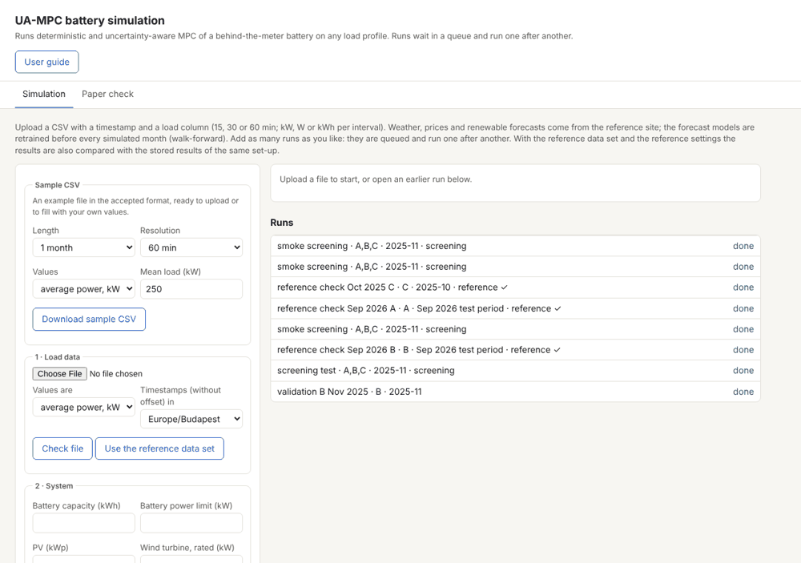
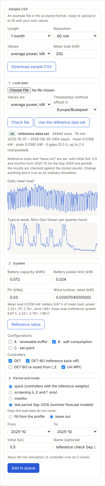
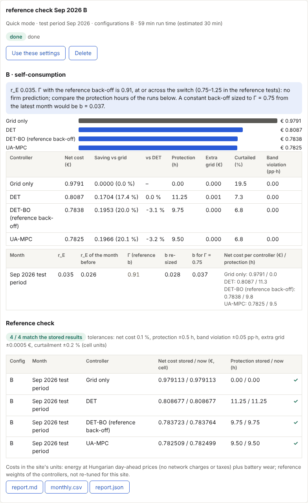
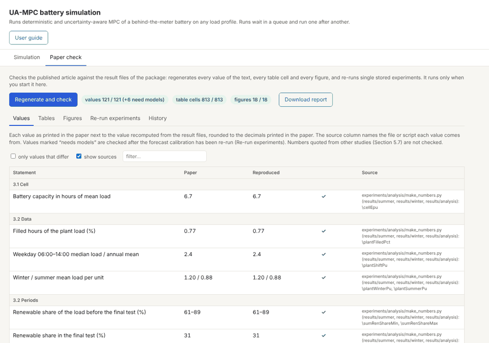
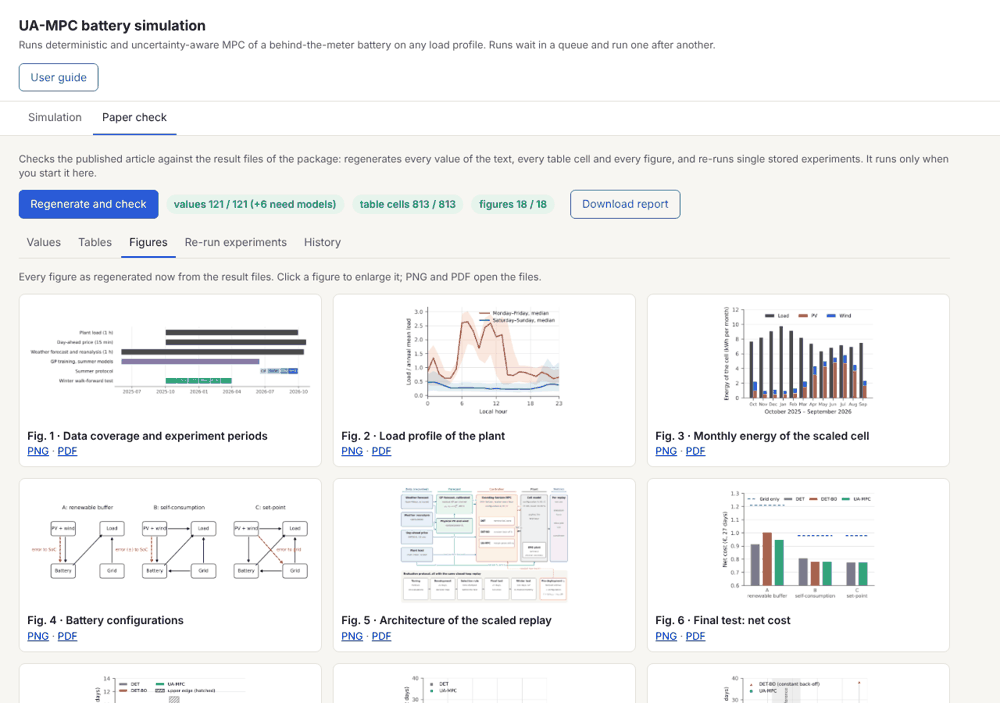
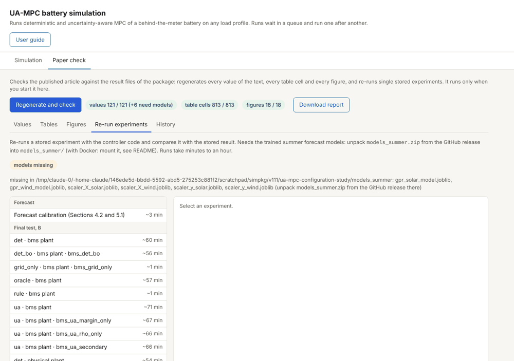

# Felhasználói útmutató

Ez az útmutató a csomag webes felületét és parancssorát írja le (1.2.2-es verzió). English version:
[`user_guide_en.md`](user_guide_en.md). A felület feliratai angolok; az útmutató a gombokat és mezőket a
felületen látható angol nevükön említi.

Az eszköz fő feladata a **szimuláció**: a szabályozókat (DET, DET-BO, UA-MPC) bármilyen feltöltött terhelési
profilon lefuttatja, az általad megadott akkuval, napelemmel és szélturbinával. Tetszőleges számú futás indítható
egymás után; ezek sorba állnak, és egyenként lefutnak. A csomagban lévő referencia-adatkészlettel és
referencia-beállításokkal futtatva a szimuláció visszaadja a tárolt eredményeket, és ezt meg is mutatja.

Emellett egy külön fülön, csak kérésre, ellenőrizhető a publikált cikk: a tárolt eredményfájlokból újragenerálja a
cikk minden számát, táblázatát és ábráját.

Tartalom: [Indítás](#1-indítás) · [A felület](#2-a-felület) · [Szimuláció](#3-szimuláció)
· [Az eredmények olvasása](#4-az-eredmények-olvasása) · [A referencia-eredmények reprodukálása](#5-a-referencia-eredmények-reprodukálása)
· [A cikk ellenőrzése](#6-a-cikk-ellenőrzése-paper-check) · [Parancssor](#7-parancssor) · [Fájlok és mappák](#8-fájlok-és-mappák)
· [Hibaelhárítás](#9-hibaelhárítás) · [Korlátok](#10-korlátok)

## 1. Indítás

### Dockerrel (Windows, macOS, Linux)

Windowson Docker Desktop kell, ahhoz pedig WSL 2 (rendszergazdaként futtatott PowerShellben `wsl --install`, majd
újraindítás).

```bash
docker build -t ua-mpc-repro .
docker run --rm -p 8501:8501 -v "$PWD/out:/pkg/out" ua-mpc-repro
```

Böngészőben: http://localhost:8501. A `-v "$PWD/out:/pkg/out"` rész megőrzi a futásokat és a betanított
előrejelzéseket két indítás között; nélküle a konténer leállásakor elvesznek.

A tárolt kísérletek újrafuttatásához és a 2026. szeptemberi tesztidőszakhoz a nyári előrejelző modellek is kellenek
(`models_summer.zip`, a v1.2.2 GitHub-release melléklete):

```bash
unzip models_summer.zip -d models_summer
docker run --rm -p 8501:8501 -v "$PWD/out:/pkg/out" -v "$PWD/models_summer:/pkg/models_summer" ua-mpc-repro
```

### Docker nélkül (Linux, macOS, WSL)

Python 3.13, a csomag gyökérmappájából:

```bash
pip install -r requirements-frozen.txt -r code/requirements.txt
python -m app.server            # http://localhost:8501  (--port, illetve --host 0.0.0.0 a módosításhoz)
```

A szerver Ctrl+C-vel áll le. A felületről indított futások a háttérben a végükig folytatódnak.

## 2. A felület

A felület két fülből áll; a **User guide** gomb ezt az útmutatót nyitja meg.

| Fül | Mire való |
|---|---|
| **Simulation** | A szimuláció: minta-CSV, feltöltés, a rendszer és a futás beállítása, a futások sora és eredményei (3–5. fejezet). Erre nyílik a felület. |
| **Paper check** | A publikált cikk ellenőrzése az eredményfájlokból, csak ha elindítod (6. fejezet). |

## 3. Szimuláció

A **Simulation** fülön. A bal oszlop az űrlap, a jobb oszlop a kiválasztott futás és a futások listája.



### 3.1 Minta-CSV (Sample CSV)

Letölthető egy mintafájl az elfogadott formátumban. Válaszd ki a hosszát (hét, hónap, év), a felbontását, a
mértékegységét és az átlagterhelést, majd nyomd meg a **Download sample CSV** gombot. A fájl azonnal visszatölthető,
vagy átírható a saját értékeidre.

### 3.2 Terhelési adat (Load data)

A fájlban két oszlop kell: időbélyeg és terhelés. Fejlécsor, `#`-tel kezdődő megjegyzéssorok, valamint `;` és `,`
elválasztó egyaránt elfogadott; `;` elválasztónál a tizedesvessző is.

```csv
timestamp,load_kw
2026-03-02 00:00+01:00,98.512
2026-03-02 01:00+01:00,96.730
```

| Tétel | Elfogadott |
|---|---|
| Felbontás | 15, 30 vagy 60 perc (fájlon belül egyforma) |
| Érték | átlagteljesítmény kW-ban vagy W-ban, vagy az intervallum energiája kWh-ban (a „Values are” mezőben választható) |
| Időbélyeg | az intervallum kezdete; UTC-eltolással (mint a mintában) vagy anélkül, ekkor a „Timestamps … in” mezőben megadott időzónában; a nyári és téli időszámítás váltását kezeli |
| Hossz | legalább egy teljes hét (minden nap minden negyedórája szerepeljen) |
| Hiányok | 2 óráig kitölti (interpoláció); a hosszabbakat jelzi |

Nyomd meg a **Check file** gombot. Az eredmény mutatja a sorok számát, az időszakot, az átlagos és a csúcsterhelést,
a hiányokat és a figyelmeztetéseket: 5 %-nál több nulla, a medián 20-szorosát meghaladó kiugrások, negatív értékek,
ismétlődő időbélyegek. Hiba esetén a feltöltés nem megy tovább. Két grafikon mutatja a napi átlagterhelést és a
tipikus hetet.

Vagy nyomd meg a **Use the reference data set** gombot: ez a csomagban lévő mért üzemi terhelést tölti be
(`code/data/industrial_load_profile.csv`, 2025. október – 2026. szeptember; leírása: `docs/data.md`), és kitölti a
referencia-rendszer méreteit és beállításait (5. fejezet).

### 3.3 Rendszer (System)

Akkukapacitás (kWh), az akku teljesítménykorlátja (kW, töltésre és kisütésre), napelem-csúcsteljesítmény (kWp) és a
szélturbina névleges teljesítménye (kW), a telephely saját mértékegységeiben. Alapértékként a referencia-rendszer
arányai jelennek meg az átlagterheléshez viszonyítva: az akku az átlagterhelés 6,67 órája, a teljesítmény 2,22-szerese,
a napelem 2,78-szorosa, a szél 1,86-szorosa. A **Reference ratios** gomb ezeket állítja vissza. A napelem és a szél
lehet 0 is.

**Configurations** – hogyan van bekötve az akku:

| | Bekötés | Hova kerül a megújuló-előrejelzés hibája |
|---|---|---|
| A | megújuló-puffer: a megújuló csak az akkut tölti; a terhelést az akku és a hálózat látja el | a hiány csökkenti a tervezett töltést, tehát eléri az akkut |
| B | saját felhasználás: a megújuló a terhelést látja el, a többletet és a hiányt az akku veszi fel | mindkét irányú eltérés eléri az akkut |
| C | alapjel-követés: az akku a tervezett teljesítményt követi, a többit a hálózat egyenlíti ki | a hálózat veszi fel; az akkuhoz nem jut (r_E = 0) |

**Controllers** – a szabályozók:

| | Szabályozó |
|---|---|
| DET | determinisztikus MPC az előrejelzés várható értékével |
| DET-BO (reference back-off) | DET állandó SoC-tartalékkal (b) a sáv mindkét szélén, a referencia-vizsgálatban hangolt értékkel (A és B) |
| DET-BO re-sized from r_E | DET-BO, amelynek b-jét minden hónapban az előző hónap r_E-jéből számolja: b = r_E (x_max − x_min) / 0,75 (A és B) |
| UA-MPC | bizonytalanság-tudatos MPC: a tartalék a kalibrált előrejelzési bizonytalanságot követi |

Alapesetként mindig fut a „csak hálózat” (akku nélküli) változat is. Minden szabályozó a referencia-cellára hangolt
súlyokkal fut.

### 3.4 Időszak és mód (Period and mode)

- **Mód.** A *quick* lefuttatja a szabályozókat. A *screening* csak az r_E-t és a Γ-t számolja hónaponként és
  bekötésenként; szabályozó nem fut, annyi ideig tart, mint az előrejelzés tanítása.
- **Időszak.** Hónapok 2025 októbere és 2026 szeptembere között, vagy a *test period Sep 2026* (2026. szeptember
  2–29., a nyári előrejelző modellekkel; ehhez a `models_summer` kell). A hónapok egymás után futnak, a SoC átöröklődik.
- **Days the load data do not cover** – a terhelési adattal nem lefedett napok. *Fill from the profile*: ilyen napon
  a terhelés az adatban szereplő, az évben legközelebbi nap ugyanazon hétköznapjáról és negyedórájáról jön (így egy
  egyhónapos fájl egy egész évet is meghajthat). *Leave out*: a szimulált időszak az adat első és utolsó napjára szűkül.
- **Initial SoC** – az első hónap kezdő töltöttsége (0,1–0,9), és egy opcionális név (**Name**) a futásnak.

A gomb fölötti sor becsüli a futásidőt. Indítás: **Add to queue** (3.5).



### 3.5 A futások sora

Az **Add to queue** a beállított futást a sor végére teszi. Ha épp nem fut semmi, azonnal indul; ha fut, megvárja.
Így egymás után tetszőleges számú futás indítható, például ugyanazzal a terheléssel más akkumérettel, más bekötéssel
vagy más hónapokkal. A futások egyenként futnak, mert egy futás már az összes processzormagot kihasználja.

A **Runs** lista minden futást mutat, az állapotával: *queued #n* (a sorban az n-edik), a futó szakasz (előrejelzés,
szimuláció, riport), *done*, *failed*, *stopped* vagy *cancelled*. Referencia-futásnál a „reference ✓/✗” is látszik.
A lista fölött: hány futás fut és hány vár.

Egy futásra kattintva a jobb panel a részleteit mutatja, és az állapotától függően ezeket a gombokat:

| Gomb | Mit csinál |
|---|---|
| **Use these settings** | Az űrlapot a futás beállításaival tölti ki (ugyanaz a terhelés is), így egy-két érték átírása után új futásként a sorba tehető. |
| **Remove from queue** | Várakozó futást kivesz a sorból. |
| **Stop** | Futó futást leállít; a kész hónapok megmaradnak, és a sor következő futása indul. |
| **Resume** | Leállított vagy hibás futást a sor végére tesz; a kész hónapoktól folytatja. |
| **Delete** | Befejezett, leállított vagy kivett futást eredményeivel együtt töröl. |

Futás közben a panel mutatja a szakaszt, szabályozónként egy folyamatjelzőt a SoC-görbével, és a jelenlegi
sebességgel számolt hátralévő időt. Az oldal bezárható; a sor a háttérben halad tovább, amíg a szerver fut.

Időigény: minden hónap előrejelzését egyszer tanítja be (1–3 perc), és a későbbi futások újrahasználják. Egy
szabályozó egy hónapja egy processzormagon kb. 15–60 perc (az UA-MPC a leglassabb); egy futáson belül a szabályozók
párhuzamosan futnak a rendelkezésre álló magokon. Ha a gép vagy a konténer leáll, a futó futás *failed* állapotba
kerül; a **Resume** folytatja. Két futás egyidejű futtatása: `OWN_PARALLEL=2` környezeti változóval indított szerver.

## 4. Az eredmények olvasása



**Értékelés** (kék doboz, bekötésenként): az időszak r_E-je, a Γ a referencia-tartalékkal és amit sugall, valamint az
az állandó tartalék, amely Γ = 0,75-öt adna.

- **r_E** – általánosított energiahiány-arány: egy rossz órában (az órák 95 %-a jobb) az akku használható
  kapacitásának mekkora részét viszi el az előrejelzési hiba. Csak az a hiba számít, amit a bekötés az akkuhoz visz,
  ezért alapjel-követésnél r_E = 0.
- **Γ** („nagy gamma”) – tartalék-kihasználtság: a rossz órás hiány osztva az állandó b tartalékkal,
  Γ = r_E (x_max − x_min) / b. 1 alatt az állandó tartalék elég, és a bizonytalanság-kezelés keveset ad hozzá;
  1 fölött nem elég. A referencia-tesztekben a váltás 0,75 és 1,25 között volt. Színek a havi táblázatban:
  zöld < 0,75, sárga 0,75–1,25, piros > 1,25.

**Oszlopdiagram és összesítő táblázat** (bekötésenként, a teljes időszakra, a te mértékegységeidben):

| Oszlop | Jelentés |
|---|---|
| Net cost (€) – nettó költség | a másnapi áron vett energia és az akku kopása, levonva az időszak végén az akkuban maradt energia értékét |
| Saving vs grid – megtakarítás | a csak hálózatos (akku nélküli) esethez képest, €-ban és %-ban |
| vs DET | a nettó költség a DET-hez viszonyítva |
| Protection (h) – védelmi idő | azon órák száma, amikor az akkumenedzsment-rendszernek (BMS) le kellett vágnia a töltést vagy a kisütést, mert a SoC elérte a sáv szélét |
| Extra grid (€) – többlet hálózati költség | az emiatt le nem szállított akkuenergia költsége |
| Curtailed (%) – levágott megújuló | a megújuló energia fel nem használt része |
| Band violation (pp·h) – sávsértés | a tervezett SoC-sávon kívüli kitérések mélysége × időtartama |

**Havi táblázat**: r_E, az előző hónap r_E-je, Γ, az újraméretezett és a javasolt tartalék, valamint szabályozónként
a nettó költség és a védelmi idő havonta.

**Reference check** (csak a referencia-adatkészlettel, 5. fejezet): minden futás a tárolt eredménnyel összevetve,
✓ ha a tűréseken belül van.

**Letöltések**: `report.md` (a teljes riport), `monthly.csv` (bekötésenként, szabályozónként és havonta egy sor,
minden mérőszámmal), `report.json` (minden adat, géppel olvasható formában).

## 5. A referencia-eredmények reprodukálása

A szimuláció ugyanazokkal a bemenetekkel visszaadja a tárolt eredményeket:

1. Nyomd meg a **Use the reference data set** gombot. Ez beállítja a méreteket: 0,072 kWh, 0,024 kW, napelem
   0,03 kWp, szél 0,0200704 kW. Ezek a referencia-cella 72 Wh-ja, 24 W-ja, 30 W-ja és 20,07 W-ja.
2. A lefedetlen napoknál maradjon a **leave out**, a kezdő SoC pedig **0,5**.
3. Válaszd ki a bekötéseket, és vagy **2025-10**-től induló hónapokat (tárolt eredmény: 2025. október – 2026. március,
   B és C), vagy a **test period Sep 2026** időszakot (A, B és C).
4. Futtasd *quick* módban.

A riportban ekkor megjelenik a **Reference check** táblázat, minden futás a tárolt párja mellett. 2026. november 4-i
ellenőrzés: a szeptemberi tesztidőszakon az A és a B, 2025 októberében a C, 2025 novemberében a B egyezett. A futások
többsége bitre azonos; a B szeptemberi DET-BO és UA-MPC futásának nettó költsége 5·10⁻⁵ relatív eltéréssel, a védelmi
idők pontosan egyeznek. Ha bármi eltér ezektől a beállításoktól, a futás közönséges szimuláció, és a riport megírja,
miért nincs összevetés.

## 6. A cikk ellenőrzése (Paper check)

A **Paper check** fül csak akkor dolgozik, ha elindítod. A **Regenerate and check** az eredményfájlokból újraépíti
a cikk számait, táblázatait és ábráit, és összeveti őket a cikkel (kb. egy perc); mellette a jelzők mutatják, hány
szövegbeli érték, táblázatcella és ábra egyezik, a **Download report** pedig letölti a riportot. Az alfülek:

| Alfül | Mit mutat |
|---|---|
| **Values** | A szövegben idézett összes számot: ahogy a cikkben áll, ahogy most kiszámolódott, ✓ vagy ✗, és hogy melyik fájlból vagy scriptből jön. Szűrhető a keresőmezővel vagy az „only values that differ” jelölővel. |
| **Tables** | Minden táblázat minden számcelláját; az eltérő cellák mindkét értékkel kiemelve. |
| **Figures** | Minden ábrát úgy, ahogy most az eredményfájlokból újragenerálódott; kattintásra nagyít, PNG-ben és PDF-ben megnyitható. (A „figures” jelző pixelenként veti össze őket a cikk ábráival: legfeljebb 1 % eltérő pixel számít azonosnak.) |
| **Re-run experiments** | Egy tárolt kísérletet futtat újra (előrejelzés-kalibráció, a szeptemberi tesztidőszak vagy a döntési térkép egy futása), és összeveti a tárolt eredménnyel. A nyári modellek kellenek hozzá. |
| **History** | A korábbi ellenőrzések riportjai és minden lépés naplója. |





**Re-run experiments.** Bal oldalt válassz egy kísérletet, majd nyomd meg a **Re-run** gombot. A panel mutatja a
lefutott MPC-megoldásokat, az eddigi SoC-görbét, a végén pedig az összevetést a tárolt eredménnyel. Tűrések: nettó
költség 0,1 %, védelmi idő ±0,5 h, sávsértés ±0,05 pp·h, többlet hálózati költség ±0,0005 €, levágott megújuló
±0,2 %. Az első újrafuttatás előkészíti a kód munkapéldányait (kb. 1,2 GB).



## 7. Parancssor

```bash
python -m app.reproduce        # ellenőrzés a cikkel; riport: out/report.md, kilépési kód 0, ha minden egyezik
docker run --rm ua-mpc-repro python -m app.reproduce
python -m pytest -q app/tests  # a feltöltés, a leképezés és a referencia-ellenőrzés egységtesztjei (pip install pytest)
```

## 8. Fájlok és mappák

| Útvonal | Tartalom |
|---|---|
| `out/report.md`, `out/report.json`, `out/reports/` | ellenőrzés a cikkel, a legutóbbi és a korábbiak |
| `out/figures/`, `out/manuscript/` | újragenerált ábrák és számok |
| `out/rerun/<id>/` | tárolt kísérletek újrafuttatásai |
| `out/own/uploads/<id>/` | ellenőrzött feltöltések |
| `out/own/jobs/<id>/` | a futások (a sor állapota a `state.json`-ban): `params.json`, `report.md`, `report.json`, `monthly.csv`, `runs/` (minden lépés CSV-ben) |
| `out/own/bundles/<hónap>/` | betanított havi előrejelzések (a későbbi futások újrahasználják; törlés után újratanítja) |

## 9. Hibaelhárítás

| Üzenet vagy jelenség | Ok és megoldás |
|---|---|
| A `docker` nem ismert parancs (PowerShell) | A Docker Desktop nincs telepítve, vagy nincs a PATH-on; telepítsd, és nyiss új PowerShellt. |
| „failed to connect to the docker API” | A Docker Desktop nem fut; indítsd el, és várd meg, amíg „running” állapotot mutat. |
| Docker Desktop: WSL not installed | Rendszergazdaként `wsl --install`, újraindítás, majd a Docker Desktop indítása. |
| „models missing” (Paper check → Re-run, test period Sep 2026) | Csomagold ki a `models_summer.zip`-et a `models_summer/` mappába, és csatold fel (1. fejezet). |
| „the resolution must be 15, 30 or 60 minutes” | Szabálytalan időbélyegek vagy más lépésköz; mintavételezd újra a fájlt. |
| „at least one full week is needed” | A fájl 7 napnál rövidebb, vagy hiányzik valamelyik nap valamelyik órája. |
| Sok negatív érték | Betáplálás vagy fordított előjel; a terhelés fogyasztás, ≥ 0. |
| „the load data cover none of the chosen months” | *Leave out* mellett olyan hónapot válassz, amelyet a fájl lefed, vagy állítsd *fill from the profile*-ra. |
| A futás *failed* állapotú | Nézd meg a naplóját a panelen; a **Resume** az utolsó kész hónaptól folytatja. |
| A futás *queued* marad | Egy másik futás fut előtte (a lista fölött látszik); a sor csak akkor halad, ha a szerver fut. |
| Nagyon lassú | Egy szabályozó egy hónapja magonként 15–60 perc; válassz kevesebb szabályozót vagy hónapot, vagy több magos gépet. |

## 10. Korlátok

- Az időjárás, a másnapi árak és a megújuló-előrejelzések a referencia-telephelyről származnak (Magyarország,
  é. sz. 48,088°, k. h. 19,910°, 2025–2026); csak a terhelés és a méretek a tieid.
- A költség a másnapi áron vett energia és az akku kopása; hálózati díjak, adók és teljesítménydíj nélkül.
- A szabályozók súlyait a referencia-cellára hangolták, a te telephelyedre nincsenek újrahangolva; hangolás után a
  szabályozók sorrendje változhat.
- Az akku a referencia-cella modellje (hatásfok 0,95, SoC-sáv 0,1–0,9, BMS-védelem), a megadott méretre skálázva; az
  öregedés, az inverter és a BMS viselkedése nem feltétlenül skálázódik vele.
- *Fill from the profile* esetén a munkaszüneti napokat nem kezeli külön.
