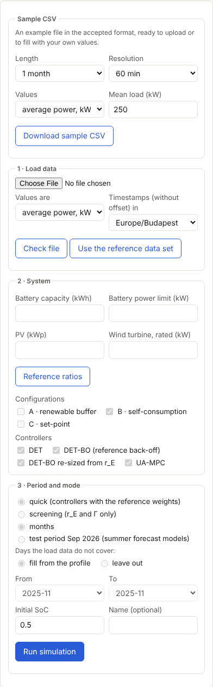
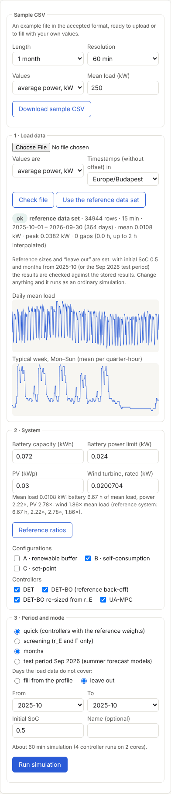
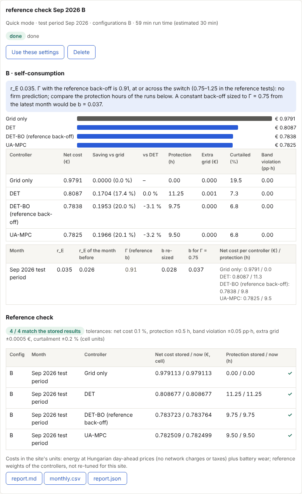
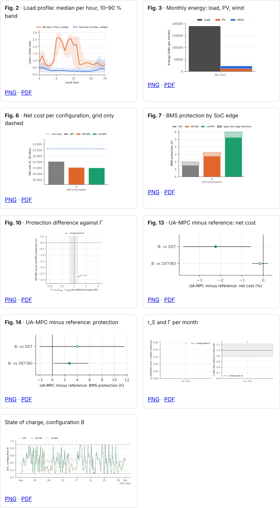
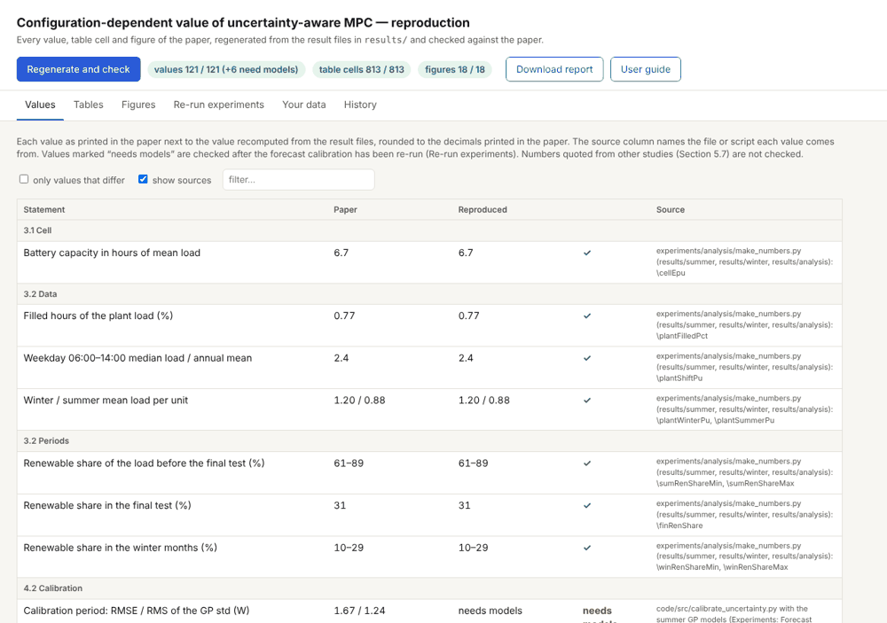
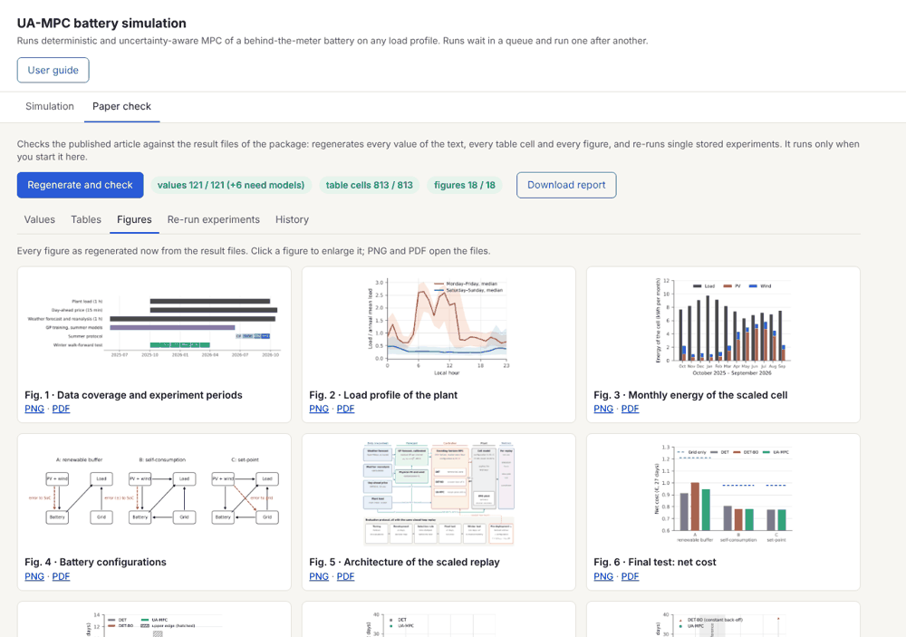
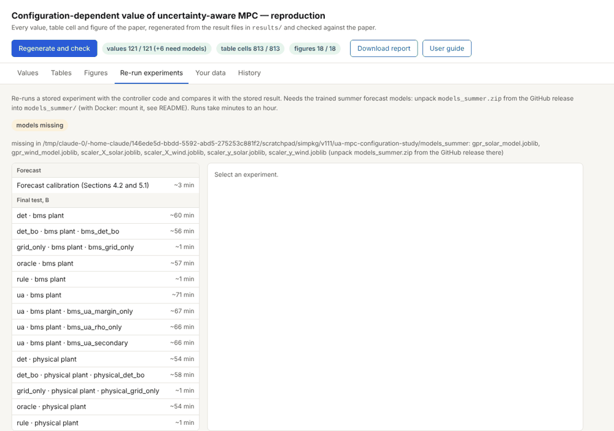

# User guide

This guide covers the web interface and command line of the package (version 1.3.2). Magyar változat:
[`user_guide.md`](user_guide.md).

The main job of the tool is **simulation**: it runs the controllers (DET, DET-BO, UA-MPC) on any load profile you
upload, with a battery, PV and wind sized by you. Any number of runs can be started one after another; they wait in a
queue and run in turn. Run with the reference data set and the reference settings shipped in the package, the
simulation reproduces the stored results and shows the comparison.

A separate tab checks the published article on request: it regenerates every number, table and figure of the article
from the stored result files.

Contents: [Starting](#1-starting) · [The interface](#2-the-interface) · [Simulation](#3-simulation)
· [Reading the results](#4-reading-the-results) · [Reproducing the reference results](#5-reproducing-the-reference-results)
· [Checking the paper](#6-checking-the-paper-paper-check) · [Command line](#7-command-line) · [Files and folders](#8-files-and-folders)
· [Troubleshooting](#9-troubleshooting) · [Limits](#10-limits)

## 1. Starting

### With Docker (Windows, macOS, Linux)

Windows needs Docker Desktop, which needs WSL 2 (`wsl --install` in an administrator PowerShell, then a restart).

```bash
docker build -t ua-mpc-repro .
docker run --rm -p 8501:8501 -v "$PWD/out:/pkg/out" ua-mpc-repro
```

Open http://localhost:8501. The `-v "$PWD/out:/pkg/out"` part keeps your runs and the trained forecasts between
starts; without it they are lost when the container stops.

For re-running stored experiments and for the September 2026 test period, also mount the summer forecast models
(`models_summer.zip`, attached to the GitHub release v1.3.2):

```bash
unzip models_summer.zip -d models_summer
docker run --rm -p 8501:8501 -v "$PWD/out:/pkg/out" -v "$PWD/models_summer:/pkg/models_summer" ua-mpc-repro
```

### Without Docker (Linux, macOS, WSL)

Python 3.13, from the package root:

```bash
pip install -r requirements-frozen.txt -r code/requirements.txt
python -m app.server            # http://localhost:8501  (--port, --host 0.0.0.0 to change)
```

Stop the server with Ctrl+C. Runs started from the interface keep running in the background until they finish.

## 2. The interface

The interface has two tabs; **User guide** opens this guide.

| Tab | What it is for |
|---|---|
| **Simulation** | Sample CSV, upload, the system and run settings, the queue of runs and their results (sections 3–5). The interface opens here. |
| **Paper check** | The check of the published article against the result files, only when you start it (section 6). |

## 3. Simulation

Tab **Simulation**. The left column is the form, the right column the selected run and the list of runs. What every
setting means and changes: [`settings_en.md`](settings_en.md).



### 3.1 Sample CSV

Download an example file in the accepted format: choose its length (week, month, year), resolution, unit and mean
load, and press **Download sample CSV**. It is ready to upload, or to overwrite with your own values.

### 3.2 Load data

The file needs two columns: a timestamp and the load. A header row, `#` comment lines and `;` or `,` separators
are accepted; decimal commas are accepted when the separator is `;`.

```csv
timestamp,load_kw
2026-03-02 00:00+01:00,98.512
2026-03-02 01:00+01:00,96.730
```

| Item | Accepted |
|---|---|
| Resolution | 15, 30 or 60 min (constant within the file) |
| Value | average power in kW or W, or energy per interval in kWh (choose under "Values are") |
| Timestamp | start of the interval; with a UTC offset (as in the sample) or without one, in the zone chosen under "Timestamps … in"; daylight-saving changes are handled |
| Length | at least one full week (every weekday and quarter-hour present) |
| Gaps | up to 2 h are interpolated; longer ones are reported |

Press **Check file**. The result lists the rows, the period, mean and peak load, gaps, and warnings (zeros above 5 %,
spikes above 20 × the median, negative values, duplicates); errors stop the upload. Two plots show the daily mean
load and the typical week.

Or press **Use the reference data set**: the measured plant load shipped with the package
(`code/data/industrial_load_profile.csv`, October 2025 – September 2026; see `docs/data.md`), with the reference
system's sizes and settings filled in (section 5).

### 3.3 System

Battery capacity (kWh), battery power limit (kW, charge and discharge), PV peak power (kWp) and wind turbine rated
power (kW), in your site's units. They are filled with the reference system's ratios to your mean load
(battery 6.67 h of mean load, power 2.22 ×, PV 2.78 ×, wind 1.86 × the mean load); **Reference ratios** restores
them. PV or wind can be set to 0.

**Configurations** — how the battery is connected:

| | Configuration | Where a renewable forecast error goes |
|---|---|---|
| A | renewable buffer: renewables only charge the battery; battery and grid supply the load | a shortfall reduces the planned charge, i.e. reaches the battery |
| B | self-consumption: renewables supply the load, the battery takes surplus and deficit | both directions reach the battery |
| C | set-point: the battery follows its planned power, the grid balances the rest | the grid; nothing reaches the battery (r_E = 0) |

**Controllers**:

| | Controller |
|---|---|
| DET | deterministic MPC on the forecast mean |
| DET-BO (reference back-off) | DET with a constant SoC reserve b at both edges of the band, as tuned in the reference study (A and B) |
| DET-BO re-sized from r_E | DET-BO whose b is set each month from the r_E of the month before: b = r_E (x_max − x_min) / Γ target, 0.75 by default (A and B); the target is set in the "Γ target" field |
| DET-BO scenario back-off | DET-BO with b = the largest 1-h deficit of the month before (scenario rule; unchecked by default) |
| DET-BO robust back-off | DET-BO with b = the largest 15-min deficit of the month before held for an hour (robust/tube rule; unchecked by default) |
| UA-MPC | uncertainty-aware MPC: the reserve follows the calibrated forecast uncertainty |

Grid only (no battery) always runs as the baseline. All controllers use the weights tuned for the reference cell.

### 3.4 Period and mode

- **Mode.** *Quick* runs the controllers. *Screening* computes only r_E and Γ per month and configuration (no
  controller runs; takes as long as the forecast training).
- **Period.** A range of months between October 2025 and September 2026, or the *test period Sep 2026* (2–29
  September 2026, with the summer forecast models; needs `models_summer`). Months are simulated one after the other
  and the SoC carries over.
- **Days the load data do not cover.** *Fill from the profile*: such a day takes the load of the same weekday and
  quarter-hour from the nearest day of the year in your data (so a one-month file can drive a whole year). *Leave
  out*: the simulated period is cut to the first and last day of your data.
- **Initial SoC** at the start of the first month (0.1–0.9), and an optional **name** for the run.

The line above the button estimates the duration. Press **Add to queue** (3.5).



### 3.5 The queue of runs

**Add to queue** puts the run at the end of the queue. If nothing is running it starts at once, otherwise it waits.
Any number of runs can be added this way, e.g. the same load with other battery sizes, configurations or months.
Runs go one at a time, because one run already uses all processor cores.

The **Runs** list shows every run with its state: *queued #n* (n-th in the queue), the current stage (forecasts,
simulating, report), *done*, *failed*, *stopped* or *cancelled*; reference runs also show "reference ✓/✗". Above the
list: how many runs are running and waiting.

Click a run to see it in the right panel, with these buttons depending on its state:

| Button | What it does |
|---|---|
| **Use these settings** | Fills the form with the run's settings (including its load), so that after changing a value it can be queued as a new run. |
| **Remove from queue** | Takes a waiting run out of the queue. |
| **Stop** | Stops a running run; finished months are kept and the next run of the queue starts. |
| **Resume** | Puts a stopped or failed run at the end of the queue; it continues from the finished months. |
| **Delete** | Deletes a finished, stopped or removed run with its results. |

While a run is running, the panel shows the stage, one progress bar per controller with its SoC trace, and the
remaining time at the current speed. You can close the page; the queue goes on in the background while the server
runs.

Durations: the forecast of each month is trained once (1–3 min) and kept for later runs. A controller takes about
15–60 min per month on one core (UA-MPC is the slowest); within a run the controllers run in parallel on the available
cores. If the machine or the container stops, the running run is marked *failed*; **Resume** continues it. To run two
runs at the same time, start the server with the environment variable `OWN_PARALLEL=2`.

## 4. Reading the results



**Verdict** (blue box, per configuration): r_E of the period, Γ with the reference back-off and what it suggests,
and the constant back-off that would give Γ = 0.75.

- **r_E** — generalised energy-deficit ratio: in a bad hour (95 % of the hours are better), the share of the usable
  battery capacity that the forecast error removes. Only the error that the configuration routes to the battery
  counts, so r_E = 0 in set-point operation.
- **Γ** ("capital gamma") — reserve utilisation: the bad-hour deficit divided by the constant reserve b,
  Γ = r_E (x_max − x_min) / b. Below 1 the constant reserve is enough and uncertainty handling adds little; above 1
  it is not. In the reference tests the switch lay between 0.75 and 1.25. Colours in the month table: green < 0.75,
  amber 0.75–1.25, red > 1.25.

**Bars and summary table** (per configuration, whole period, in your units):

| Column | Meaning |
|---|---|
| Net cost (€) | energy bought at the day-ahead price plus battery wear, minus the value of the energy left in the battery at the end |
| Saving vs grid | against grid only (no battery), in € and % |
| vs DET | net cost relative to DET |
| Protection (h) | hours in which the battery management system had to cut charge or discharge because the SoC reached the band edge |
| Extra grid (€) | cost of the energy the battery could not deliver because of these cuts |
| Curtailed (%) | share of the renewable energy that could not be used |
| Band violation (pp·h) | depth × duration of SoC excursions outside the planned band |

**Month table**: r_E, r_E of the month before, Γ, the re-sized, the recommended, the scenario and the robust back-off, and net cost /
protection hours of each controller per month.

**Γ check, hour by hour** (when DET-BO ran in A or B): a back-off b holds b·E above the lower SoC limit. An hour
that starts inside this reserve can end at the limit only if the forecast deficit reaching the battery within that
hour is larger than the reserve. The table classifies every re-planning hour: started inside with the deficit within
the reserve / started inside with a larger deficit / started with the reserve already used. Each cell gives the hours
in which the BMS stopped the discharge, of all hours in the class. The first class should have none (it would
contradict the bound; the winter test of the paper had none). Many in the last class mean the reserve was used up
over several hours, which a one-hour Γ does not see: a larger b helps there.

**Reference check** (only with the reference data set; section 5): each run against the stored result, ✓ when
within the tolerances.

**Figures** (after every run, in the style and layout of the article's figures, computed from this run; PNG and
PDF, click to enlarge). The file names are those of the article's figure scripts:

| File | Article figure | What it shows | When |
|---|---|---|---|
| `fig02_load_profile` | Fig. 2 | load / mean: weekday and weekend median per hour, 10–90 % band | always |
| `fig03_monthly_energy` | Fig. 3 | load, PV and wind energy per month (kWh) | always |
| `fig05_net_cost` | Fig. 6 | net cost per configuration and controller, grid only dashed | quick |
| `fig06_protection` | Fig. 7 | BMS protection hours by SoC edge: lower edge filled, upper edge hatched | quick |
| `fig16_gamma` | Fig. 10 | DET-BO minus UA-MPC protection per month against Γ (A, B) | quick, with DET-BO and UA-MPC |
| `fig10_monthly_saving` | Fig. 11 | saving against grid only per month (%), renewable share under each month | quick, several months |
| `fig11_monthly_protection` | Fig. 12 | protection hours per month and controller (A, B) | quick, several months |
| `fig15a_summary_cost` | Fig. 13 | UA-MPC minus each reference: net cost (%), 95 % paired daily bootstrap interval; filled dot: the interval excludes zero | quick |
| `fig15b_summary_protection` | Fig. 14 | the same for protection (h) | quick |
| `rE_gamma` | (a table in the article) | r_E and Γ per month and configuration | always (screening too) |
| `soc_<config>` | – | state of charge over the whole run, per controller | quick |



The numbers of Figs. 13–14 are in `figures/summary_ua_minus_reference.csv`. Two differences from the article: the
net-cost axis does not start at zero (so that the differences show), and the daily bootstrap uses the days of this
run, not the article's whole test period.

**Downloads** (in your units: kW, kWh, €; SoC as a fraction of the capacity):

| File | Content |
|---|---|
| `results.zip` | everything below in one file, with the figures |
| `report.md`, `report.json` | the full report, readable and machine-readable |
| `totals.csv` | the summary table (configuration × controller) |
| `monthly.csv` | the same per month |
| `gamma.csv` | r_E, Γ and the back-offs per month |
| `gamma_windows.csv` | the Γ check: every re-planning hour of DET-BO with its starting SoC, deficit and reserve within the hour (kWh), class and BMS intervention |
| `steps.csv` | **every 15-min step** of every controller: SoC, load, grid, charge, discharge, renewable, curtailed, price, cost, charge/discharge cut by the BMS |
| `mpc_solves.csv` | **every MPC solve (re-plan)**, one row per hour and controller: start SoC, the forecast and its spread it saw, load, price, the effective SoC limits, the first planned step (grid, charge, discharge, curtailment), the planned SoC at the end of the re-planning interval and of the horizon, the confidence weight, solver time, iterations, success and the terms of the objective (the latter in the solver's own units) |

## 5. Reproducing the reference results

The simulation reproduces the stored results when it gets the same inputs:

1. **Use the reference data set**, or upload the `reference_load_profile_2025-26.csv` file linked on the tab (unchanged, at any scale); it is recognised as the reference data set. This sets the reference cell's sizes (72 Wh battery, 24 W power,
   30 W PV, 20.07 W wind) in the units of the file: with the button 0.072 kWh / 0.024 kW / 0.03 kWp / 0.0200704 kW, with
   the file (mean 1 kW) 6.674 kWh / 2.225 kW / 2.781 kWp / 1.860 kW.
2. Keep **leave out** for days outside the data and initial SoC **0.5**.
3. Choose the configurations and either months starting in **2025-10** (stored: October 2025 – March 2026 for B and
   C) or the **test period Sep 2026** (A, B and C).
4. Run in quick mode.

The report then contains a **Reference check** table with each run against the stored one. Checked on
2026-11-04: B and A in the September 2026 test period, C in October 2025 and B in November 2025 all matched (most
runs bit for bit; DET-BO and UA-MPC of B in September within 5·10⁻⁵ of the net cost, protection hours equal). If
anything differs from these settings, the run is an ordinary simulation and the report says why it is not compared.

## 6. Checking the paper (Paper check)

The **Paper check** tab works only when you start it. **Regenerate and check** rebuilds the article's numbers,
tables and figures from the result files and compares them with the article (about a minute); the chips next to it
show how many values, table cells and figures match, and **Download report** saves the report. The sub-tabs:

| Sub-tab | What it shows |
|---|---|
| **Values** | Every number quoted in the text: as printed, as recomputed, ✓ or ✗, and the file or script it comes from. Filter with the search box or "only values that differ". |
| **Tables** | Every numeric cell of every table; differing cells are highlighted with both values. |
| **Figures** | Each figure as regenerated now from the result files; click to enlarge, open as PNG or PDF. (The "figures" chip compares them with the article's figures pixel by pixel; ≤ 1 % differing pixels counts as identical.) |
| **Re-run experiments** | Re-runs a stored experiment (forecast calibration, a run of the September test period or of the decision map) and compares it with the stored result. Needs the summer models. |
| **History** | Reports of earlier checks and the log of every step. |





**Re-run experiments.** Pick an experiment on the left, press **Re-run**. The panel shows the MPC solves done, the
SoC of the run so far and, at the end, the comparison with the stored result (net cost within 0.1 %, protection
within 0.5 h, band violation within 0.05 pp·h, extra grid cost within 0.0005 €, curtailment within 0.2 %). The
first re-run prepares working copies of the code (about 1.2 GB).



## 7. Command line

```bash
python -m app.reproduce        # check against the article; report in out/report.md, exit code 0 if all match
docker run --rm ua-mpc-repro python -m app.reproduce
python -m pytest -q app/tests  # unit tests of the upload, mapping and reference check (pip install pytest)
```

## 8. Files and folders

| Path | Content |
|---|---|
| `out/report.md`, `out/report.json`, `out/reports/` | check against the article, latest and earlier |
| `out/figures/`, `out/manuscript/` | regenerated figures and numbers |
| `out/rerun/<id>/` | re-runs of stored experiments |
| `out/own/uploads/<id>/` | checked uploads |
| `out/own/jobs/<id>/` | the runs (queue state in `state.json`): `params.json`, `report.md`, `report.json`, `export/` (the downloads and figures), `runs/` (steps and MPC log in cell units) |
| `out/own/bundles/<month>/` | trained monthly forecasts (reused by later runs; delete to retrain) |

## 9. Troubleshooting

| Message or symptom | Cause and fix |
|---|---|
| `docker` is not recognised (PowerShell) | Docker Desktop is not installed or not on the PATH; install it and open a new PowerShell. |
| "failed to connect to the docker API" | Docker Desktop is not running; start it and wait until it reports "running". |
| Docker Desktop: WSL not installed | `wsl --install` in an administrator PowerShell, restart, start Docker Desktop. |
| "models missing" (Paper check → Re-run, test period Sep 2026) | unpack `models_summer.zip` into `models_summer/` and mount it (section 1). |
| "the resolution must be 15, 30 or 60 minutes" | the timestamps are irregular or another step; resample the file. |
| "at least one full week is needed" | the file is shorter than 7 days or some weekday and hour are missing. |
| many negative values | export or a sign convention; the load must be consumption ≥ 0. |
| "the load data cover none of the chosen months" | with *leave out*, choose months the file covers, or use *fill from the profile*. |
| run marked *failed* | see its log (in the panel); **Resume** continues from the last finished month. |
| run stays *queued* | another run is running before it (shown above the list); the queue moves only while the server runs. |
| very slow | each controller and month takes 15–60 min per core; choose fewer controllers or months, or a machine with more cores. |

## 10. Limits

- Weather, day-ahead prices and renewable forecasts are those of the reference site (Hungary, 48.088 °N, 19.910 °E,
  2025–2026); only the load and the sizes are yours.
- Costs are energy at day-ahead prices plus battery wear, without network charges, taxes or demand charges.
- The controller weights were tuned for the reference cell and are not re-tuned for your site; the ranking of the
  controllers can change after tuning.
- The battery is the reference cell model (efficiency 0.95, SoC band 0.1–0.9, BMS protection) scaled to your size;
  ageing, inverter and BMS behaviour need not scale with it.
- In *fill from the profile*, public holidays are not treated separately.
